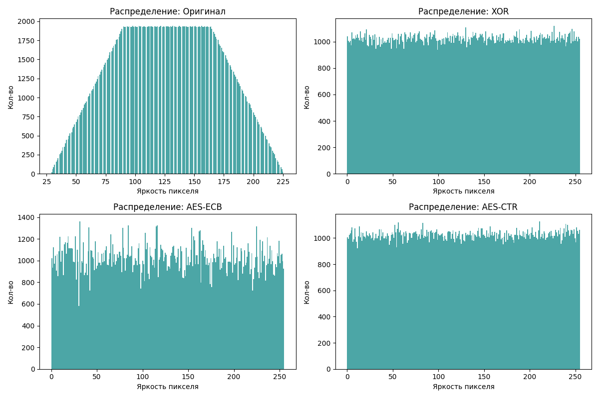
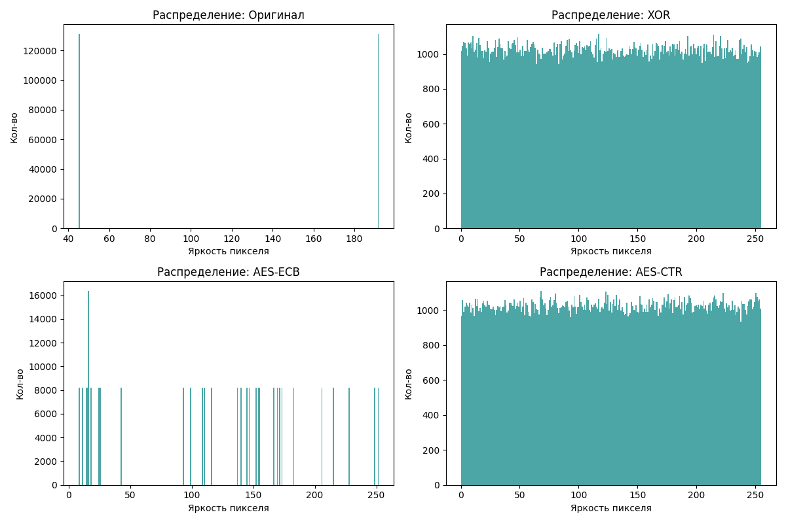

# Лабораторная работа №1
## Шифрование изображений и статистическое сравнение методов

### 1. Постановка задачи
Методы шифрования: потоковый XOR (на основе xorshift32), блочный AES-ECB и AES-CTR. Для анализа я выбрала два изображения: gradient.png и checkerboard.png.
Сравнение методов проводилось по энтропии, корреляции соседних пикселей, гистограммам и чувствительности к изменению ключа (NPCR/UACI).

### 2. Реализация
1. Потоковый вариант (XOR)

Я написала свой генератор случайных чисел xorshift32. Он работает на битовых сдвигах (влево 13, вправо 17, влево 5) и XOR. Из строкового пароля считается хэш SHA-256, первые 4 байта которого становятся начальным состоянием генератора. Генератор в цикле выдает 32-битные числа, которые разбиваются на 4 байта и для каждого байта делается XOR с байтом ключевого потока.

2. AES

Я сделала с библиотекой cryptography. В режиме ECB данные сначала дополняются до размера, кратного 16 байтам (паддинг), а потом шифруются независимыми блоками. В режиме CTR используется 16-байтовый nonce (одноразовый номер), который генерируется случайным образом. Ключ AES выводится из пароля через PBKDF2-HMAC-SHA256 с случайной солью. В файл фото.meta.json сохраняются salt, nonce, количество итераций и SHA-256 исходного изображения. XOR, ECB, CTR тоже сохраняются в отдельные .bin.

3. Проверка обратимости

Я реализовала функции расшифрования для всех трех методов. Сначала шифрую и расшифровываю в памяти, сравниваю с оригиналом. Если совпадает, пишет True. Можно запустить расшифровку из сохранённых бинарников после перезапуска программы.

скрин 

4. Сохранение метрик

Сводная таблица записывается в metrics.csv. Там все значения энтропии и корреляции для каждого изображения и NPCR/UACI для AES-CTR. 

### 3. Методика эксперимента
*   Основное статистическое сравнение для gradient.png и checkerboard.png.
*   Метрики: энтропия Шеннона, корреляция Пирсона, гистограммы, NPCR и UACI.
*   Для оценки корреляции использовались все соседние пары пикселей изображения (по горизонтали и вертикали).
*   Эксперимент с изменением ключа выполнялся для метода AES-CTR. Изображение шифровалось двумя ключами, которые отличаются ровно на 1 бит (я меняла младший бит в первом байте ключа), после чего результаты сравнивались.

### 4. Результаты

1. Сводная таблица метрик 

Для gradient.png

| Метод | Энтропия | Корр H | Корр V |
| Оригинал | 7.4137 | 1.0000 | 0.9999 |
| XOR | 7.9993 | 0.0013 | -0.0012 |
| AES-ECB | 7.9900 | 0.0006 | 0.3534 |
| AES-CTR | 7.9992 | 0.0016 | 0.0019 |

Для checkerboard.png

| Метод | Энтропия | Корр H | Корр V |
| Оригинал | 1.0000 | 0.9413 | 0.9413 |
| XOR | 7.9992 | -0.0025 | -0.0027 |
| AES-ECB | 4.9375 | 0.0700 | 0.9763 |
| AES-CTR | 7.9993 | -0.0011 | -0.0001 |

2. Гистограммы

У исходной картинки gradient.png гистограмма в форме трапеции, тк это градиент (плавный переход от темного к светлому дает такую фигуру). У XOR и AES-CTR графики стали ровными, как прямоугольники, то есть значения яркости распределились равномерно и исходная фигура исчезла. У AES-ECB гистограмма осталась кривой, потому что одинаковые блоки исходного градиента превратились в одинаковые блоки шифротекста, и статистика картинки частично сохранилась. 

Для checkerboard.png гистограмма выглядит как 2 пика (2 цвета). После XOR и AES-CTR распределение стало равномерным. У AES-ECB гистограмма осталась с явными пиками, тк повторяющиеся блоки доски зашифровались одинаково.

3. NPCR и UACI (для AES-CTR)

Для gradient.png: NPCR = 99.61%, UACI = 33.47%

Для checkerboard.png: NPCR = 99.59%, UACI = 33.39%

4. Проверка обратимости

хэши SHA-256 исходного и восстановленного изображений совпали для всех трех методов (XOR, AES-ECB, AES-CTR) на обоих изображениях. При запуске из сохранённых файлов программа тоже показала True для всех методов, те расшифровка после перезапуска работает.

### 5. Анализ

1. Корреляция

У XOR и AES-CTR корреляция упала почти до нуля (0.0013 и 0.0016). У AES-ECB вертикальная корреляция осталась высокой (0.3534 и 0.9763), так как одинаковые блоки шифруются одинаково. 

2. Энтропия

У XOR и AES-CTR энтропия почти максимальная (7.9994), поэтому распределение равномерное. У AES-ECB она ниже (7.9900 и 4.9375) из-за сохранения статистических закономерностей.

3. Почему ECB отличается от CBC/CTR

ECB шифрует каждый блок независимо от предыдущих блоков, поэтому одинаковые блоки данных дают одинаковый шифротекст. На шахматной доске много одинаковых блоков, поэтому ECB практически не скрывает узор. CTR использует потоковое шифрование, где каждый бит зависит от позиции и ключа, поэтому разрушается структура.

4. Согласованность графиков и чисел

У ECB гистограмма рваная, тк высокая корреляция и маленькая энтропия. У XOR и CTR ровные гистограммы из-за энтропии близкой к 8 и нулевой корреляцией. Это совпадает с цифрами в CSV, которые теперь можно посмотреть в одной таблице.

### 6. Итоговый вывод
По итогам работы можно сделать вывод, что ECB не подходит для шифрования изображений из-за сохранения структуры (высокая корреляция, рваная гистограмма). Это особенно видно на checkerboard.png. 