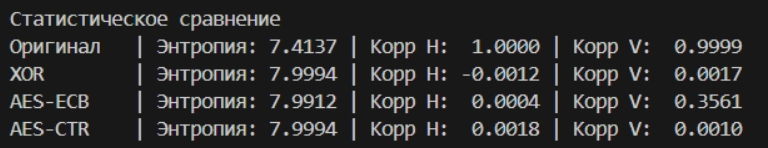
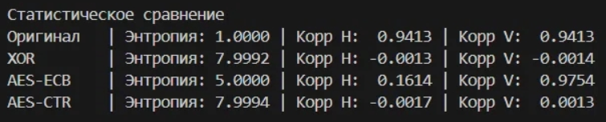
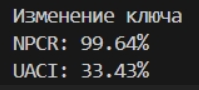
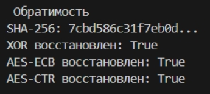
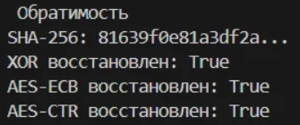

# Лабораторная работа №1
## Шифрование изображений и статистическое сравнение методов

### 1. Постановка задачи
Методы шифрования: потоковый XOR (на основе xorshift32), блочный AES-ECB и AES-CTR. Для анализа я выбрала два изображения: gradient.png и checkerboard.png.
Сравнение методов проводилось по энтропии, корреляции соседних пикселей, гистограммам и чувствительности к изменению ключа (NPCR/UACI).

### 2. Реализация
1. Потоковый вариант (XOR)

Я написала свой генератор случайных чисел xorshift32. Он работает на битовых сдвигах (влево 13, вправо 17, влево 5) и XOR. Из строкового пароля считается хэш SHA-256, первые 4 байта которого становятся начальным состоянием генератора. Генератор в цикле выдает 32-битные числа, которые разбиваются на 4 байта и для каждого байта делается XOR с байтом ключевого потока.

2. AES

Я сделала с библиотекой cryptography. В режиме ECB данные сначала дополняются до размера, кратного 16 байтам (паддинг), а потом шифруются независимыми блоками. В режиме CTR используется 16-байтовый nonce (одноразовый номер), который генерируется случайным образом. Чтобы можно было расшифровать файл после перезапуска программы, я сохраняю этот nonce в файл results/meta.json в hex-формате.

3. Проверка обратимости

Я реализовала функции расшифрования для всех трех методов. Я шифрую, расшифровываю и сравниваю с оригиналом. Если совпадает, показывает true, иначе false.

### 3. Методика эксперимента
*   Основное статистическое сравнение для gradient.png и checkerboard.png.
*   Метрики: энтропия Шеннона, корреляция Пирсона, гистограммы, NPCR и UACI.
*   Для оценки корреляции использовались все соседние пары пикселей изображения (по горизонтали и вертикали).
*   Эксперимент с изменением ключа выполнялся для метода AES-CTR. Изображение шифровалось двумя ключами, которые отличаются ровно на 1 бит (я меняла младший бит в первом байте ключа), после чего результаты сравнивались.

### 4. Результаты

1. Сводная таблица метрик 

Для gradient.png

Для checkerboard.png

2. Гистограммы

У исходной картинки gradient.png гистограмма в форме трапеции, тк это градиент (плавный переход от темного к светлому дает такую фигуру). У XOR и AES-CTR графики стали ровными, как прямоугольники, то есть значения яркости распределились равномерно и исходная фигура исчезла. У AES-ECB гистограмма осталась кривой, потому что одинаковые блоки исходного градиента превратились в одинаковые блоки шифротекста, и статистика картинки частично сохранилась. 

Для checkerboard.png гистограмма выглядит как 2 пика (2 цвета). После XOR и AES-CTR распределение стало равномерным. У AES-ECB гистограмма осталась с явными пиками, тк повторяющиеся блоки доски зашифровались одинаково.

3. NPCR и UACI (для AES-CTR)

Для gradient.png:

Для checkerboard.png:

4. Проверка обратимости

хэши SHA-256 исходного и восстановленного изображений совпали для всех трех методов (XOR, AES-ECB, AES-CTR) на обоих изображениях.

### 5. Анализ

1. Корреляция

У XOR и AES-CTR корреляция упала почти до нуля на обоих изображениях (-0.0012 и 0.0018 по горизонтали для градиента). У AES-ECB вертикальная корреляция осталась высокой (0.3561 для градиента и 0.9754 для шахматной доски), так как одинаковые блоки шифруются одинаково. 

2. Энтропия

У XOR и AES-CTR энтропия приблизилась к максимальной (7.9994 бит) на обоих изображениях. Поэтому распределение равномерное. У AES-ECB она ниже (7.9912 для градиента и 5 для шахматной доски) из-за сохранения статистических закономерностей.

3. Почему ECB отличается от CBC/CTR

ECB шифрует каждый блок независимо от предыдущих блоков, поэтому одинаковые блоки данных дают одинаковый шифротекст. На шахматной доске много одинаковых блоков, поэтому ECB практически не скрывает узор. CTR используют потоковое шифрование, где каждый бит зависит от позиции и ключа, поэтому разрушается структура.

4. Согласованность графиков и чисел

У ECB гистограмма рваная, тк высокая корреляция и маленькая энтропия. У XOR и CTR ровные гистограммы из-за энтропии близкой к 8 и нулевой корреляцией. 

### 6. Итоговый вывод
По итогам работы можно сделать вывод, что ECB не подходит для шифрования изображений из-за сохранения структуры (высокая корреляция, рваная гистограмма). Это особенно видно на checkerboard.png. Режимы XOR и AES-CTR намного эффективнее, потому что они равномерно распределяют и у них нулевая корреляция. 