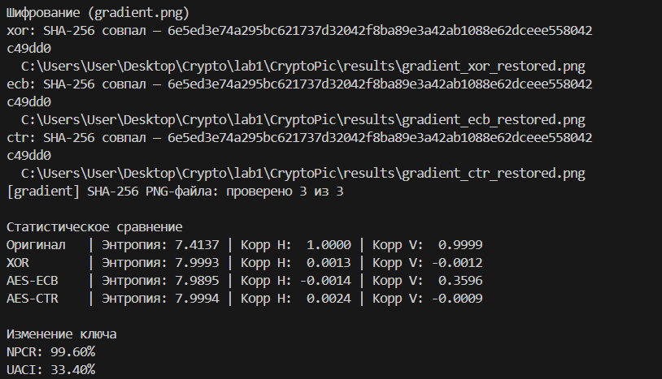
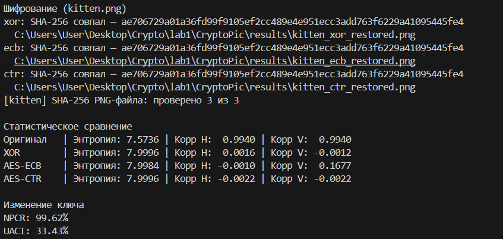
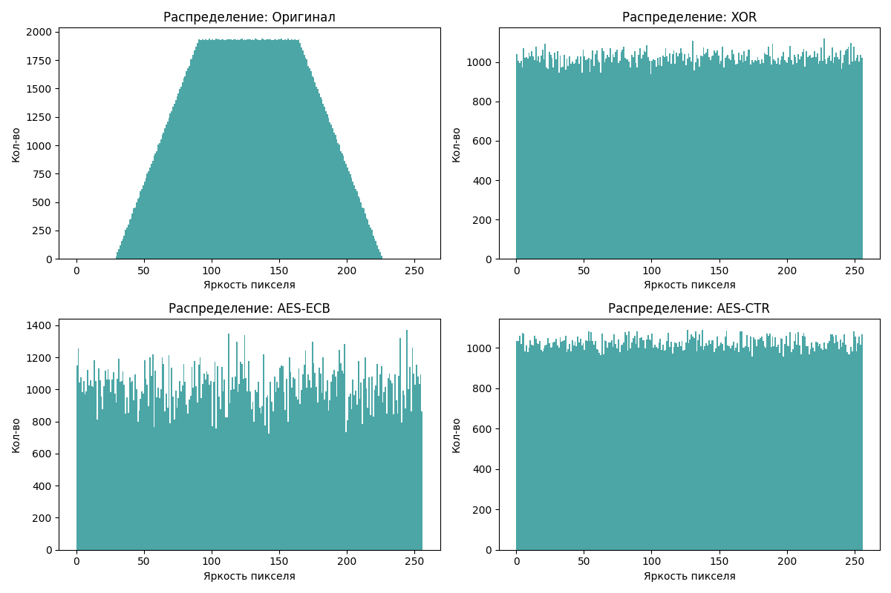
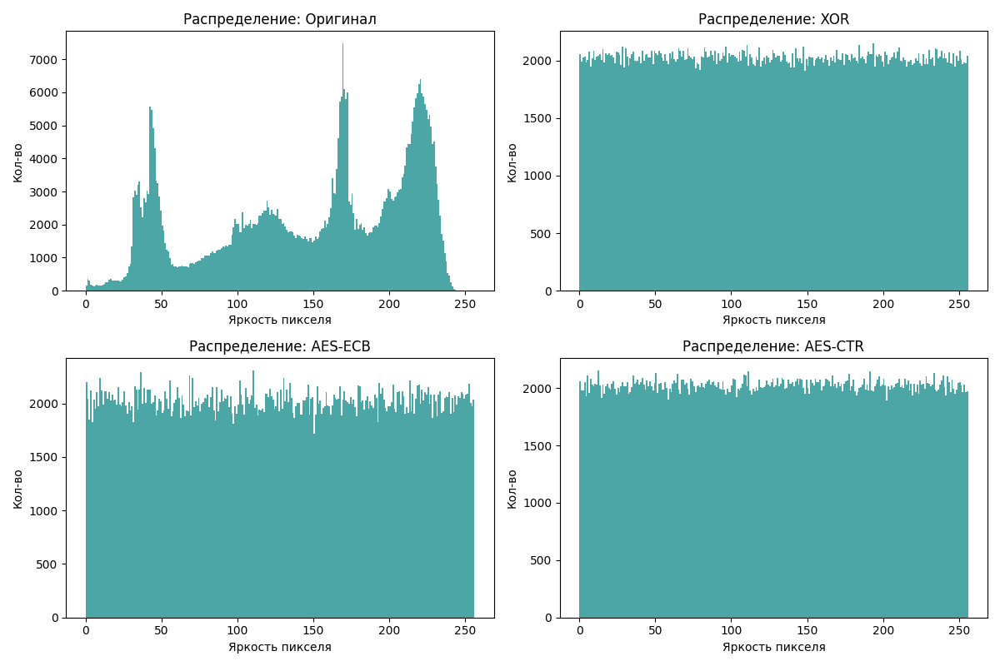
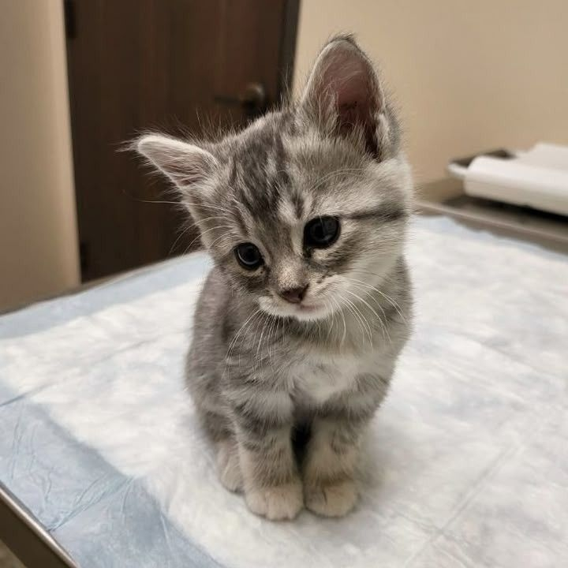
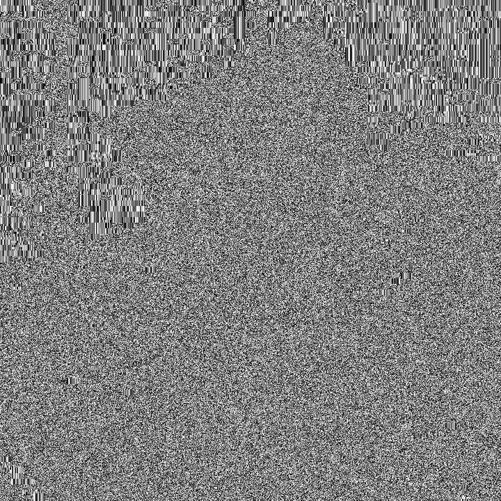
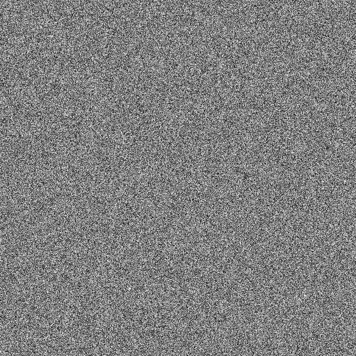

# Лабораторная работа №1

## Шифрование изображений и статистическое сравнение методов

### 1. Постановка задачи

три способа шифрования: потоковый XOR на основе XorShift32, AES-ECB и AES-CTR. Для эксперимента я взяла два изображения: градиент gradient.png размером 512 × 512 и фотографию котенка kitten.png размером 720 × 720.

### 2. Реализация

#### 1) Потоковый вариант XOR

Для XOR я использовала генератор XorShift32. Сначала из строки вычисляется хэш SHA-256 и его первые четыре байта программа переводит в целое число и использует как начальное состояние генератора. При шифровании всего PNG в эту строку входят пароль и соль. В опыте с яркостями тоже используется пароль.

Генератор с помощью сдвигов на 13, 17 и 5 бит и операции XOR вычисляет 32-битное число. Каждое такое число дает четыре байта ключевого потока. Затем функция xor_crypt() складывает каждый байт данных с соответствующим байтом потока через XOR.

Для расшифрования используется та же функция. Если повторить XOR с тем же ключевым потоком, то поулчатся исходные байты. 

#### 2) Шифрование AES

Для AES я использовала библиотеку cryptography. derive_aes_key() получает ключ из пароля через PBKDF2-HMAC-SHA256 и для каждого изображения создается соль 16 байт и 200 000 итераций. На выходе получается 16-байтовый ключ, поэтому используем AES-128.

В ECB данные делятся на блоки по 16 байт. Если последний блок неполный, программа добавляет байты по правилу PKCS#7. При расшифровки программа проверяет дополнение и убирает его. 

В CTR AES шифрует значения счетчика. Из них получается поток, который складывается с данными через XOR, для следующего блока используется следующее значение счетчика. Дополнение здесь не нужно, потому что для последнего блока можно взять столько байтов потока, сколько осталось данных.

#### 3) Что сохраняется для расшифрования

Зашифрованные байты каждого PNG сохраняются в трех файлах .bin. Еще создается файл .meta.json. В нем сохраняются размеры изображения, SHA-256 исходного файла, соль, число итераций PBKDF2, имена бинарных файлов и начальные значения счетчика CTR.

В метаданных есть два поля для CTR. Поле nonce соответствует шифрованию полного PNG, а pixel_nonce используется для статистического опыта с яркостями. При расшифровании полного файла программа берет nonce, а ключ заново получает из того же пароля и соли.

#### 4) Как проверяется обратимость

Сначала программа вычисляет SHA-256 исходного PNG. После шифрования она читает сохраненные .bin и .meta.json и расшифровывает данные, затем вычисляет SHA-256 полученных байтов и сравнивает его с сохраненным хэшем исходника. Если хэши совпали, программа сохраняет восстановленный PNG и записывает ок в таблицу результатов.

### 3. Методика эксперимента

#### 1) Какие данные сравнивались

Для каждого из двух изображений я сравнивала исходник, XOR, AES-ECB и AES-CTR. Для проверки обратимости программа шифровала весь PNG-файл. Для статистического сравнения она отдельно переводила изображение в оттенки серого и шифровала значения яркости. Полученные байты раскладывались по сетке исходного размера, чтобы их можно было сравнить как изображения.

#### 2) Какие метрики рассчитывались

- Энтропия Шеннона -это насколько равномерно встречаются значения яркости. 
- Корреляция Пирсона - насколько связаны яркости соседних пикселей. Corr H для соседей по горизонтали, Corr V по вертикали. 
- Гистограмма - сколько раз встретилось каждое значение яркости от 0 до 255. 

#### 3) Как проверялось изменение ключа

Для каждого изображения я дважды шифровала один и тот же массив яркостей через AES-CTR. Во втором ключе меняла младший бит первого байта операцией key2[0] ^= 1. Начальное значение счетчика в обеих попытках было одинаковым, поэтому в этом опыте менялся только ключ.

Два результата шифрования сравнивались по NPCR и UACI. NPCR показывает, какой процент байтов изменился. UACI показывает, насколько сильно в среднем отличаются значения этих байтов. 
### 4. Результаты

#### 1) Сводная таблица метрик

| Изображение | Метод | Энтропия, бит | Corr H | Corr V |
|---|---|---:|---:|---:|
| gradient.png | Оригинал | 7,4137 | 1,0000 | 0,9999 |
| gradient.png | XOR | 7,9993 | 0,0013 | −0,0012 |
| gradient.png | AES-ECB | 7,9895 | −0,0014 | 0,3596 |
| gradient.png | AES-CTR | 7,9994 | 0,0024 | −0,0009 |
| kitten.png | Оригинал | 7,5736 | 0,9940 | 0,9940 |
| kitten.png | XOR | 7,9996 | 0,0016 | −0,0012 |
| kitten.png | AES-ECB | 7,9984 | −0,0010 | 0,1677 |
| kitten.png | AES-CTR | 7,9996 | −0,0022 | −0,0022 |

(metrics.csv)

#### 2) Гистограммы и зашифрованные изображения

У градиента гистограмма похожа на трапецию. Средние значения яркости встречаются чаще, чем очень темные или очень светлые. После XOR и AES-CTR распределение стало почти равномерным. У AES-ECB разброс высоты столбцов заметнее.

У котика исходная гистограмма имеет несколько пиков. После шифрования значения распределены по всему диапазону яркостей. Гистограмма AES-ECB тоже выглядит довольно ровной, но на самом изображении после ECB еще заметны полосы и отдельные участки исходной структуры. После AES-CTR изображение выглядит как шум.

#### 3) NPCR и UACI для AES-CTR

| Изображение | NPCR | UACI |
|---|---:|---:|
| gradient.png | 99,60% | 33,40% |
| kitten.png | 99,62% | 33,43% |

На обоих картинках после изменения одного бита ключа поменялись почти все байты. 

#### 4) Проверка обратимости

| Изображение | XOR | AES-ECB | AES-CTR |
|---|---|---|---|
| gradient.png | SHA-256 совпал | SHA-256 совпал | SHA-256 совпал |
| kitten.png | SHA-256 совпал | SHA-256 совпал | SHA-256 совпал |

На обоих скриншотах видно, что совпало.

### 5. Анализ

#### 1) Как изменилась корреляция

У обоих горизонтальная и вертикальная корреляция были близки к 1. После XOR и AES-CTR значения в обоих направлениях стали близки к 0.

После AES-ECB горизонтальная корреляция тоже стала близка к нулю. Вертикальная осталась заметной: 0,3596 на градиенте и 0,1677 на фотографии.

#### 2) Как изменилась энтропия

У XOR и AES-CTR энтропия на обоих изображениях получилась близкой к 8 битам. У AES-ECB она тоже выросла. Особенно это видно на фотографии, где энтропия после ECB составила 7,9984 бита, хотя на зашифрованной картинке остались полосы.

Энтропия учитывает, как часто встречаются значения яркости. По ней можно оценить распределение значений, а корреляция дополнительно показывает, связаны ли между собой соседние пиксели.

#### 3) Почему ECB отличается от CTR

В ECB одинаковые блоки исходных данных шифруются одинаково. Если такие блоки повторяются в соседних строках, в результате тоже могут повторяться участки. Это видно на фото по полосам и что вертикальная корреляция после ECB осталась выше, чем XOR и CTR.

В CTR для разных блоков берутся разные значения счетчика. Поэтому одинаковые исходные блоки получают разные участки ключевого потока. В этом опыте после CTR гистограммы стали ровнее, а корреляция по горизонтали и вертикали оказалась близкой к 0.

### 6. Итоговый вывод

Все три метода позволили восстановить исходные PNG, и для каждого восстановленного файла совпал SHA-256. При этом методы по-разному изменили структуру изображений. После XOR и AES-CTR распределение яркостей стало почти равномерным, а связь между соседними пикселями сильно уменьшилась. У AES-ECB даже при энтропии, близкой к 8, осталась вертикальная корреляция, а на фотографии были заметны полосы.