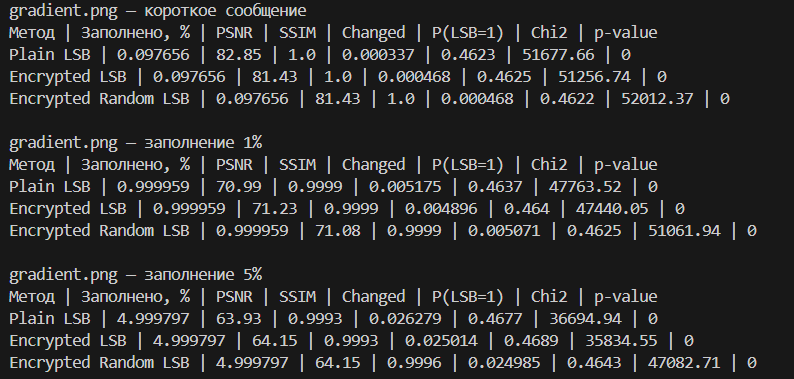
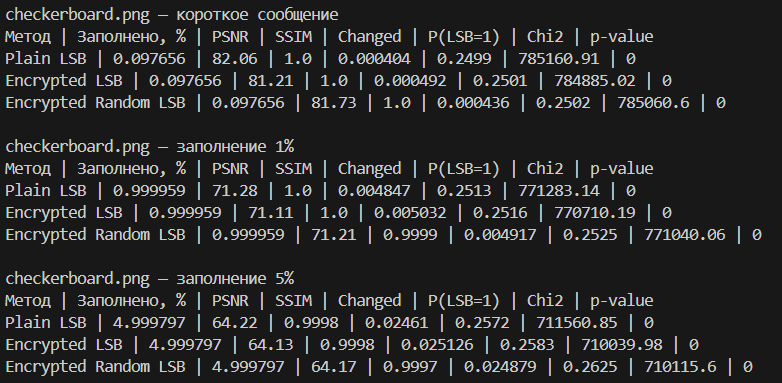
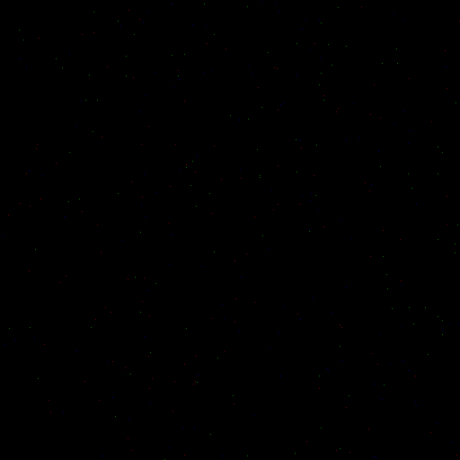
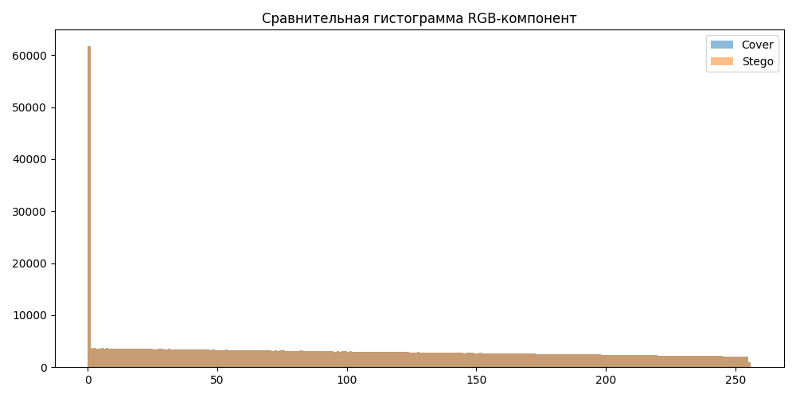
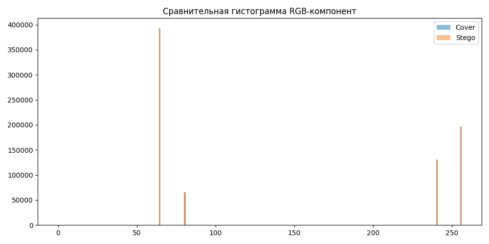

# Лабораторная работа № 2

## Стеганография, шифрование и статистический анализ

### 1. Постановка задачи

Цель работы: спрятать текст в PNG-изображении, извлечь его обратно и посмотреть, как меняется картинка в зависимости от способа встраивания и объёма данных.

Я сравнила три варианта:

- Plain LSB - Открытый текст с нулевым дополнением.
- Encrypted LSB - Пакет с зашифрованным текстом, тоже делается подряд с начала изображения.
- Encrypted Random LSB - Тот же зашифрованный пакет, но с перемешанными позициями, которые зависят от пароля.

Для опытов я взяла gradient.png и checkerboard.png (размер 512 × 512 пикселей). У градиента значения цветовых компонентов распределены по широкому диапазону. У шахматного изображения несколько значений встречаются гораздо чаще остальных. Поэтому результаты для каждой картинки я сравнивала с её исходником.

Для короткого опыта я использовала сообщение "Laboratory work in cryptography. Secret message.". Вместе с точкой в конце это 48 байт в UTF-8. Ещё два опыта провела при заполнении 1% и 5% ёмкости изображения. 

### 2. Реализация

#### 1) Как выполняется LSB-встраивание

LSB - это младший значащий бит. У каждого RGB-пикселя три цветовых компонента: красный, зелёный и синий. Значение каждого компонента хранится в одном байте и лежит в диапазоне от 0 до 255.

В embed_lsb() изображение переводится в RGB и загружается в массив. Вызов reshape(-1) выстраивает компоненты в один ряд: сначала R, G, B первого пикселя, затем R, G, B второго и тд. После этого к каждому компоненту можно обратиться по одному индексу.

Запись бита: (component & 0xFE) | bit. Маска 0xFE в двоичной записи 11111110. Операция & обнуляет младший бит компонента, а операция | записывает туда нужный бит сообщения. При чтении component & 1 оставляет только младший бит, и результат сохраняется в PNG, который сохраняет значения компонентов без потерь.

#### 2) Как хранится длина сообщения

При извлечении нужно знать, где заканчиваются спрятанные данные, для этого перед пакетом надо записать заголовок длиной 4 байта. В нём хранится длина следующего за ним пакета тоже в байтах.

В embed_lsb() выражение struct.pack(">I", len(payload)) превращает длину пакета в четыре байта, потом программа присоединяет к заголовку пакет. bits_from_bytes() раскладывает эту запись на отдельные нули и единицы.

При извлечении extract_lsb() сначала читает 32 бита заголовка, собирает их в четыре байта с помощью bytes_from_bits() и через struct.unpack() получает длину пакета. Затем она считывает столько битов, сколько нужно для восстановления этого количества байтов. В случайном варианте первые 32 бита берутся из первых 32 позиций перестановки.

#### 3) Как проверяется вместимость

В каждый RGB-компонент встраивается по одному биту, ёмкость = ширина × высота × 3. Для моих изображений получается 512 × 512 × 3.

Перед записью программа проверяет, что пакет непустой и что (4 + длина пакета) × 8 помещается в ёмкость. При извлечении она проверяет, что картинка вмещает хотя бы заголовок и что длина пакета положительна и помещается. Если проверка не проходит, то будет ошибка.

#### 4) Как выполняется шифрование

В двух зашифрованных вариантах я использовала AES-256-GCM. AES - симметричный алгоритм, он использует один и тот же секретный ключ для шифрования и для расшифрования. GCM - режим работы AES, который создаёт тег для проверки целостности при расшифровании.

Пароль вводится как строка. get_key() кодирует его в UTF-8 и передаёт полученные байты в PBKDF2-HMAC-SHA256 вместе с солью, где PBKDF2 получает ключ из пароля. В моей программе 200000 итераций, чтобы каждая попытка подобрать пароль требовала больше вычислений. dklen=32 это длина результата в 32 байта (256 бит).

В encrypt_payload() программа генерирует соль и nonce через os.urandom(). Соль используется для клуча, nonce передаётся в AES-GCM при шифровании и расшифровании.

Когда decrypt_payload() получает пакет, она достаёт из него соль и nonce, с тем же паролем и той же солью get_key() снова вычисляет тот же ключ. Библиотека проверяет тег и возвращает байты текста, а потом программа декодирует их из UTF-8. 

#### 5) Какие служебные данные сохраняются

- Заголовок длины: 4 байта
- Соль: 16 байт
- Nonce: 12 байт
- Шифртекст: столько же байтов, сколько занимает исходный текст
- Тег GCM: 16 байт

Соль, nonce и тег занимают 44 байта. Вместе с заголовком длины получается 48 служебных байтов.

#### 6) Как формируется псевдослучайный порядок позиций

get_seed() хэширует пароль с помощью SHA-256. Хэш-функция преобразует входные данные в результат фиксированной длины, потом SHA-256 выдаёт 32 байта. Одинаковый пароль даёт одинаковый хэш, поэтому из этого хэша программа берёт первые четыре байта и через int.from_bytes превращает их в 32-битное число.

Полученное число это seed (начальное состояние XorShift32). Генератор с помощью сдвигов и XOR вычисляет следующее число, сохраняет его как новое состояние и повторяет это при следующем вызове.

get_random_positions() использует числа генератора в алгоритме Фишера - Йетса. Сначала создаётся список всех индексов RGB-компонентов, потом мы идём по списку с конца и меняем текущий элемент местами с одним из элементов остальной части. 

#### 7) Как проверяется результат

Для каждого изображения и каждой нагрузки embed_experiment() создаёт 3 картинки. После сохранения каждого PNG программа сразу вызывает extract_experiment(). Она открывает файл, извлекает пакет и сверяет его с тем, который передали на запись. После программа рассчитывает метрики для этого PNG и ставит в CSV отметку verified = ok.

### 3. Методика эксперимента

#### 1) Какой объём данных использовался

В каждом опыте я использовала один и тот же текст для всех трёх методов. При 1% текст занимал 935 байт, а при заполнении 5% = 4 867 байт. Дополнительно я проверила короткую фразу из 48 байт. Этот прогон использовался для проверки извлечения и построения картинок.

(результаты из metrics.csv)

#### 2) Какие два уровня payload сравнивались

Payload задан как доля ёмкости изображения, которую занимает вся запись. Я сравнивала два целевых уровня - 1% и 5%. Для каждого уровня experiment_text() считает, сколько целых байтов помещается в заданную долю ёмкости, и вычитает 4 байта заголовка и 44 байта служебных данных. В оставшийся объём функция помещает повторённую фразу нужной длины.

В зашифрованных вариантах 44 байта занимают соль, nonce и тег. В Plain LSB к тексту добавляются 44 нулевых байта, чтобы при одной нагрузке все три метода занимали одинаковое место. Для Encrypted LSB и Encrypted Random LSB используется один и тот же зашифрованный пакет.

| Целевой уровень | Текст, байт | Пакет без заголовка, байт | Записано, бит | Фактическое заполнение |
|---|---:|---:|---:|---:|
| 1% | 935 | 979 | 7 864 | 0,999959% |
| 5% | 4 867 | 4 911 | 39 320 | 4,999797% |

(результаты из metrics.csv)

#### 3) Какие метрики рассчитывались

##### PSNR, SSIM и доля изменений

- PSNR - насколько сильно различаются значения компонентов исходника и стегоизображения. Чем меньше разности, тем выше PSNR.
- SSIM - показывает сходство структуры изображений (яркость, контраст и светлые и тёмные значения). Чем ближе SSIM к 1, тем больше сходство.
- Changed - количество реально изменённых RGB-компонентов. Если у одного пикселя изменились два канала, счётчик увеличится на два.
- Младшие биты: analyze_image() считает статистику по всем трём RGB-каналам. У каждого компонента берётся младший бит, затем программа считает, какая доля младших битов равна единице P(LSB = 1). Доля нулей 1 - P(LSB = 1).
- Хи-квадрат - насколько наблюдаемые частоты отличаются от ожидаемых, где значения RGB-компонентов сравниваются попарно: 0 и 1, 2 и 3, ..., 254 и 255. В calculate_chi2() ожидается, что значения в паре встречаются одинаково часто.
- У каждой непустой пары есть одна степень свободы. Если есть общее количество элементов пары, то можно с помощью одной частоты вычислить вторую.
- p-value - насколько вероятно получить такое же большое или ещё большее хи-квадрат при условии, что проверяемая гипотеза верна. Гипотеза: частоты внутри пар равны. Если p-value маленькое, то расхождение с равенством сильное.

#### 4) На каких изображениях проводился основной эксперимент

На gradient.png и checkerboard.png.

### 4. Результаты

#### 1) Сводная таблица метрик

В таблице 12 опытов: по три метода для каждой картинки при нагрузках 1% и 5%. Во всех случаях исходный текст удалось восстановить.

| Изображение | Payload | Метод | PSNR, дБ | SSIM | Changed | Changed ratio | P(LSB = 0) | P(LSB = 1) | хи-квадрат | p-value |
|---|---:|---|---:|---:|---:|---:|---:|---:|---:|---:|
| gradient.png | 1% | Plain LSB | 70,99 | 0,9999 | 4 070 | 0,005175 | 0,5363 | 0,4637 | 47 763,52 | 0,0 |
| gradient.png | 1% | Encrypted LSB | 71,23 | 0,9999 | 3 850 | 0,004896 | 0,5360 | 0,4640 | 47 440,05 | 0,0 |
| gradient.png | 1% | Encrypted Random LSB | 71,08 | 0,9999 | 3 988 | 0,005071 | 0,5375 | 0,4625 | 51 061,94 | 0,0 |
| gradient.png | 5% | Plain LSB | 63,93 | 0,9993 | 20 667 | 0,026279 | 0,5323 | 0,4677 | 36 694,94 | 0,0 |
| gradient.png | 5% | Encrypted LSB | 64,15 | 0,9993 | 19 672 | 0,025014 | 0,5311 | 0,4689 | 35 834,55 | 0,0 |
| gradient.png | 5% | Encrypted Random LSB | 64,15 | 0,9996 | 19 649 | 0,024985 | 0,5357 | 0,4643 | 47 082,71 | 0,0 |
| checkerboard.png | 1% | Plain LSB | 71,28 | 1,0000 | 3 812 | 0,004847 | 0,7487 | 0,2513 | 771 283,14 | 0,0 |
| checkerboard.png | 1% | Encrypted LSB | 71,11 | 1,0000 | 3 957 | 0,005032 | 0,7484 | 0,2516 | 770 710,19 | 0,0 |
| checkerboard.png | 1% | Encrypted Random LSB | 71,21 | 0,9999 | 3 867 | 0,004917 | 0,7475 | 0,2525 | 771 040,06 | 0,0 |
| checkerboard.png | 5% | Plain LSB | 64,22 | 0,9998 | 19 354 | 0,024610 | 0,7428 | 0,2572 | 711 560,85 | 0,0 |
| checkerboard.png | 5% | Encrypted LSB | 64,13 | 0,9998 | 19 760 | 0,025126 | 0,7417 | 0,2583 | 710 039,98 | 0,0 |
| checkerboard.png | 5% | Encrypted Random LSB | 64,17 | 0,9997 | 19 566 | 0,024879 | 0,7375 | 0,2625 | 710 115,60 | 0,0 |

Для сравнения я взяла метрики исходников. У gradient.png доля единиц в LSB = 0,4622, доля нулей = 0,5378, а хи-квадрат = 52 106,76. У checkerboard.png = 0,2500, 0,7500 и 786 432,00. В обоих случаях p-value в выводе равно 0,0.

#### 2) Результаты для двух уровней payload

При 1% в каждое изображение записалось 7 864 бита, при 5% = 39 320 бит. 

#### 3) Карта разности

Карты сделаны для короткого сообщения в режиме Encrypted Random LSB. Чёрный фон - значения совпали, цветные это изменеие изменения, усиленные в 100 раз.

На градиенте изменилось 368 RGB-компонентов, на шахматном изображении = 343. 

#### 4) Сравнительная гистограмма

По горизонтали идут значения RGB-компонентов от 0 до 255, по вертикали - сколько раз встречается каждое значение. На графиках сравниваются исходники и стегоизображения из того же опыта с коротким сообщением.

У градиента есть высокий пик около нуля. У шахматного изображения четыре пика, потому что у его RGB-компонентов всего четыре возможных значения. На графиках разница между исходными картинками и картинками с сообщением почти не видна.

### 5. Анализ

#### 1) Где PSNR и SSIM выше или ниже

На градиенте при 1% PSNR выше у Encrypted LSB = 71,23 дБ. SSIM у всех методов одинаковый = 0,9999.

На градиенте при 5% PSNR выше у Encrypted LSB и Encrypted Random LSB = 64,15 дБ. SSIM выше у Encrypted Random LSB = 0,9996.

На шахматах при 1% PSNR выше у Plain LSB = 71,28 дБ. SSIM выше у Plain LSB и Encrypted LSB = 1,0000.

На шахматах при 5% PSNR выше у Plain LSB = 64,22 дБ. SSIM выше у Plain LSB и Encrypted LSB = 0,9998.

#### 2) Как меняется доля изменённых компонентов

При 1% менялось около 0,5% компонентов, а при 5% около 2,5%. Так получилось потому, что часть битов уже совпадала с теми, которые программа записывала.

#### 3) Что происходит с распределением LSB

В исходном градиенте доля единиц была 0,4622, а на шахматах 0,2500. После записи при 5% у Encrypted Random LSB доля 0,4643 на градиенте и 0,2625 на шахматах. 

#### 4) Как меняются хи-квадрат и p-value

Во всех 12 опытах хи-квадрат снизился, те частоты внутри пар стали ближе друг к другу. 

В выводе p-value везде равно 0,0, в том числе у исходных картинок. Программа отображает так очень маленькие значения, поэтому для сравнения я смотрела на то, насколько менялся сам хи-квадрат относительно исходника.

#### 5) Как шифрование влияет на статистическую заметность

Я сравнила Plain LSB и Encrypted LSB, потому что оба записывают биты подряд. При 5% хи-квадрат у зашифрованного варианта получился немного ниже на обоих картинках. Например, на градиенте было 36 694,94 у Plain LSB и 35 834,55 у Encrypted LSB.

#### 6) Что изменяет псевдослучайное размещение

Я сравнила два зашифрованных варианта, у них один и тот же пакет и менялся только порядок записи. На картах разности видно, что при перемешивании изменения появляются в разных местах.

На градиенте при 5% хи-квадрат у случайного варианта оказался ближе к значению исходника. На шахматном изображении результаты двух вариантов были почти одинаковый. Поэтому эффект перемешивания зависит от картинки.

#### 7) Как рост payload отражается на метриках

При переходе с 1% на 5% менялось больше компонентов, поэтому PSNR снижался. Например, на градиенте у Encrypted Random LSB количество изменений выросло с 3 988 до 19 649, а PSNR упал с 71,08 до 64,15 дБ. Хи-квадрат тоже снизился, а SSIM во всех опытах близким к 1.

### 6. Итоговый вывод

Все три метода позволили спрятать и восстановить текст на обеих картинках. Чем больше данных я записывала, тем больше компонентов менялось, а сами изображения оставались похожими на исходные.

Шифрование защищало текст, а перемешивание меняло места, куда записывались биты. По статистике видно различия между способами, но результаты зависят от исходной картинки.
