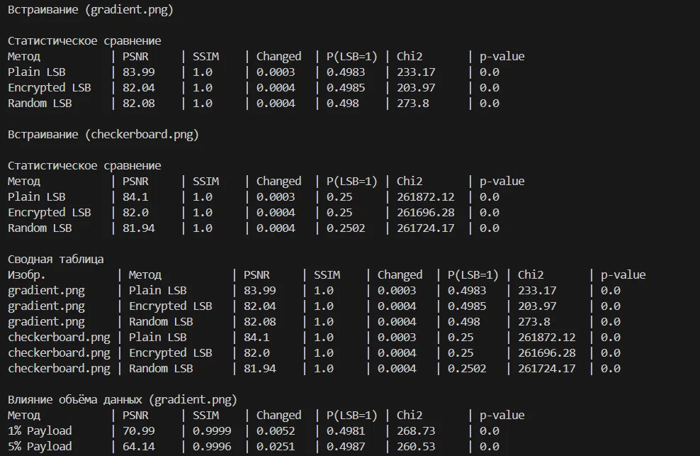
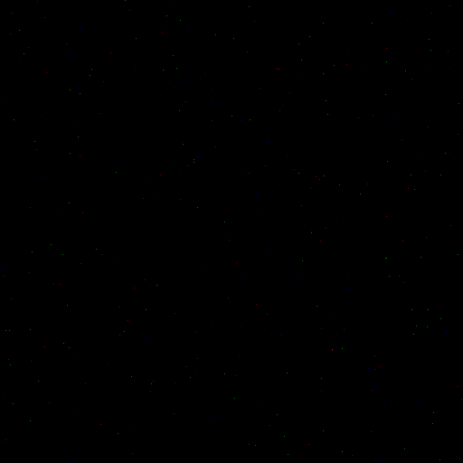
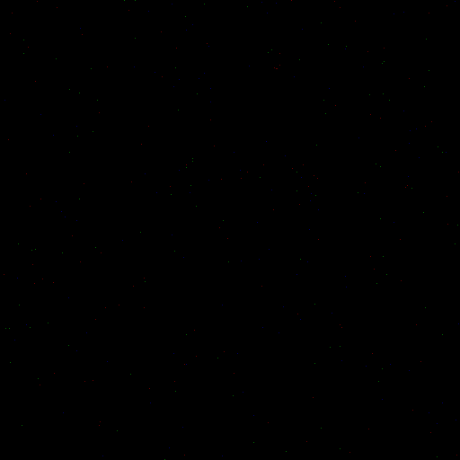
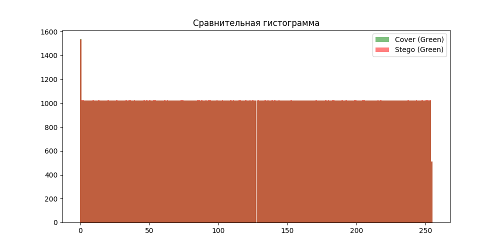
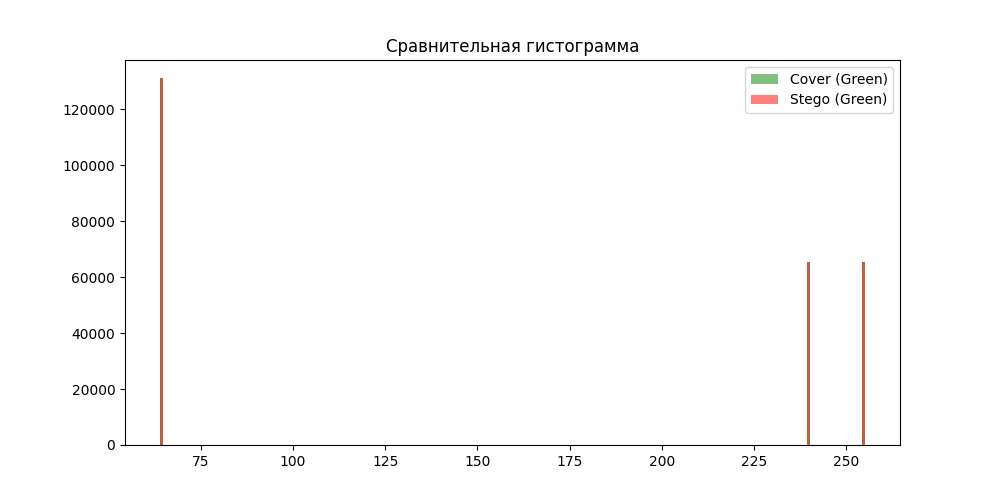

# Лабораторная работа №2
## Стеганография, шифрование и статистический анализ

### 1. Постановка задачи

Варианты для сравнения: обычный Plain LSB (открытый текст), Encrypted LSB (зашифрованный текст) и Encrypted Random LSB (зашифрованный текст в псевдослучайном порядке).

Изображения: gradient.png и checkerboard.png.

Сообщение: Laboratory work in cryptography. Secret message (52 байта).

### 2. Реализация
**LSB-встраивание и длина сообщения**
Я реализовала классический LSB. Изображение переводится в массив RGB, и младший бит каждого канала заменяется на бит сообщения через побитовую операцию (pixel & 0xFE) | bit. В первые 32 бита изображения записывается длина встраиваемого пакета.

**Проверка вместимости**
Общая вместимость вычисляется как width * height * 3 (тк 3 канала). Если длина сообщения + 32 бита на служебную информацию превышает этот объем, программа выбрасывает ошибку.

**Шифрование и служебные данные**
Перед встраиванием текст шифруется алгоритмом AES-128 в режиме CTR. Ключ выводится из пароля через PBKDF2-HMAC-SHA256. Для обратного восстановления в начало пакета добавляются соль и nonce. 

**Псевдослучайный порядок**
Для третьего варианта я использовала свой ГПСЧ XorShift32 из первой лабораторной. На его основе алгоритм Фишера-Йетса перемешивает массив всех индексов пикселей, создавая уникальную последовательность позиций без повторений. Сид генератора берется из хэша пароля.

### 3. Методика эксперимента
Объём данных: Сообщение 52 байта. Для проверки влияния объёма (п. 13 задания) я встраивала данные на **1%** и **5%** от общей ёмкости изображения gradient.png.

Метрики: 

* Для незаметности PSNR и SSIM. 
* Для оценки статистической структуры доля изменённых пикселей (Changed), доля единиц в младших битах (P(LSB=1)) и критерий Хи-квадрат (\(\chi^2\)) и p-value.

Визуализация:  Карта разности (усиленная в 100 раз) и сравнительная гистограмма.

Изображения: gradient.png и checkerboard.png. Влияние объёма на gradient.png.

### 4. Результаты

# Визуализация

difference_gradient.png и difference_checkerboard.png

Карта разности выглядит как черный фон с цветными точками. Так как позиции выбираются псевдослучайно, изменения равномерно размазываются по всему холсту, имитируя естественный цифровой шум. 

gradient.png

checkerboard.png

На обеих гистограммах исходного изображения и стего-изображения полностью совпадают. Для gradient.png график имеет равномерное распределение, для checkerboard.png три выраженных пика, но в обоих случаях красный и зеленый цвета накладываются друг на друга. 

### 5. Анализ
1. PSNR

PSNR больше 80 дБ, поэтому разницу вообще не видно. Plain LSB дал чуть больше (83.99 дБ), а Encrypted LSB чуть меньше (81.68 дБ). 

2. Доля изменённых компонент

В Plain LSB доля изменений минимальна (0.0003), так как текст предсказуем. В Encrypted и Random LSB доля изменений выше (0.0004 - 0.0005), что подтверждает случайный характер зашифрованных данных.

3. Распределение LSB

У checkerboard.png равно 0.25 для всех вариантов из-за черно-белых квадратов. Для gradient.png видно, что распределение стремится к идеальным 0.5 (около 0.498).

4. Хи-квадрат и p-value

На checkerboard.png \(\chi^2\) равно 261 000. Оно такое большое, поточу что сама картинка состоит из резких черных и белых квадратов. На gradient.png \(\chi^2\) адекватные (205–272), но p-value всё равно 0.0, то есть тест заметил даже 52 байта.

5. Влияние шифрования и псевдослучайного размещения

Шифрование превращает предсказуемый текст в псевдослучайную последовательность, поэтому снижается \(\chi^2\) для gradient.png (с 233.17 до 205.36). Псевдослучайное размещение (Random LSB) немного увеличивает \(\chi^2\) (до 272.52), так как изменения затрагивают пиксели по всей площади. 

6. Влияние объёма данных

При переходе с 1% на 5% заполнения PSNR падает с 70.99 дБ до 64.11 дБ, а Changed ratio вырастает с 0.0052 до 0.0253. Чем больше данных мы прячем, тем сильнее портим исходное изображение, так что так и должно быть. SSIM при этом остается высоким (0.9996), так как изменения все еще малеьнике.

### 6. Итоговый вывод
По итогам работы можно сказать, что шифровать сообщение перед LSB-встраиванием надо обязательно. Иначе открытый текст сразу видно по статистике (по младшим битам), а зашифрованный текст выглядит как обычный шум. Особенно это заметно на gradient.png. 